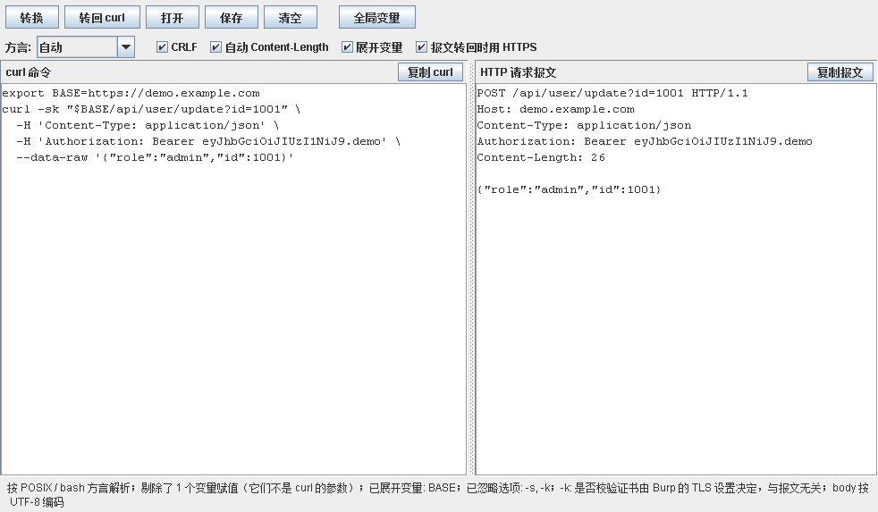

# curl2burp

**curl 命令 ⇄ 原始 HTTP 报文**，双向转换的离线小工具：粘一条 curl，得到能直接粘进 Burp Repeater / Yakit 的报文；在 Burp 里改完包，也能变回一条可直接执行的单行 curl。




Java 8 + Swing，零第三方依赖，单个 jar，全程离线，只做文本转换——发不发、发给谁，仍然由你决定。

## 它解决的几件事

| | |
|---|---|
| **双向** | curl → 报文、报文 → 单行 curl；`报文 → curl → 报文` 往返**逐字节一致**，191 条断言守着 |
| **算得对** | `Content-Length` 按 body 的实际字节数（中文 3 字节）；`../`、`//`、`%00` 原样进请求行，不规范化 |
| **认得方言** | POSIX/bash、cmd、PowerShell 的引号与续行规则不同，自动判定，判错了可手动指定 |
| **看得见变量** | `export A=b` / `set A=b` / `$env:A='b'` 声明行剥离并展开；常用变量可用「全局变量」一次设好 |
| **不静默丢弃** | 忽略的选项、`-x` 代理、未声明变量都会在状态栏列出（⚠ 转橙色），不猜、不吞 |

---

## 为什么需要它

用智能体做渗透测试，探测动作大多是 `curl` 命令：让模型发一条请求、看回显、判断有没有戏。这条路很快，但**验证环节**会卡住——你想把这条命令搬进 Burp Suite 或 Yakit 里改包、重放、对比两次响应，就得先把它变成这两个工具认识的形态：**原始 HTTP 报文**。

智能体给的是 shell 命令，Burp / Yakit 要的是报文，中间这一步没有顺手的工具：

- **手工拼**：拆引号、认 `-H`、把 `-d` 的内容数成 `Content-Length`、再补一个空行。一条带 Cookie 和 JSON body 的命令十几行，慢，而且一定会算错。`Content-Length` 差一个字节，发出去服务端就一直在等 body 直到超时，现象是「目标不响应」——很容易被误判成目标挂了。
- **在线转换站**：内网目标、真实 Cookie 和 Token 全贴进别人的请求体里，合规上过不去。
- **Postman / Insomnia 导入**：它是「自己的请求模型」，落到 Burp 还得再导出、再修 `Content-Length`；而且会把 `../`、`//`、`%00` 规范化掉——恰恰是越权测试要原样发出去的东西。

curl2burp 就是补这一步的：全程离线、单文件、不联网，只做文本转换，发不发、发给谁，仍然由你决定。

## 典型用法

- 智能体给出一条 curl → 转成报文 → 粘进 Burp Repeater 改包重放
- Burp 里改完 → 转回**单行** curl → 贴回给智能体继续验证
- 要原样发出 `/a/../b`、`//api//x`、`/x%00y` 这类畸形路径时（本工具不做路径规范化）
- 要手工构造异常 `Content-Length`、空值头、重复头的测试包时

## 快速开始

需要 JRE 8 或更高版本，没有别的依赖。

```bash
java -jar curl2burp.jar
```

三步走完一个来回：

1. **左栏粘 curl** —— 连 `export BASE=...` 这类声明行一起粘也没关系，声明行会被剥掉、`$BASE` 会被展开。
2. **按 `Ctrl+Enter`** —— 右栏出原始报文，点右上角「复制报文」整段复制，粘进 Burp Repeater / Yakit 就能改包重放。
3. **改完再按 `Ctrl+Enter`** —— 把 Burp 里的报文粘进右栏、按 `Ctrl+Enter`，左栏出**单行** curl，点「复制 curl」贴回给智能体继续验证。

Windows 下也可以直接双击 `run.bat`。它用 `javaw` 起窗口版，黑色控制台窗口**立刻关掉**（不会挂在那儿），所以误点控制台也不会把工具一起关掉。想在前台看日志就用上面的 `java -jar`。

界面左右两栏：左栏粘 curl，右栏出报文。每栏右上角各有一个复制按钮——左栏「**复制 curl**」、右栏「**复制报文**」，点哪个就复制哪个框，不存在「顶部按钮到底复制哪一栏」的问题。

| 操作 | 快捷键 |
|---|---|
| curl → 报文（在左栏按） | `Ctrl+Enter` |
| 报文 → curl（在右栏按） | `Ctrl+Enter` |
| 撤销 / 重做 | `Ctrl+Z` / `Ctrl+Y`（或 `Ctrl+Shift+Z`） |

选项栏还有：输入方言、CRLF / LF 切换、是否自动写 `Content-Length`、是否展开变量、报文转回时默认用 HTTPS。工具栏右侧的「**全局变量**」用来预设 `BASE`、`TOKEN` 这类反复出现的变量。

底部状态栏会把提示整段折行显示（文本可选中复制）：窗口变窄时自动多占几行，最多 6 行，再长就在栏内滚动，不用再拖宽窗口才能看全。

## 行为约定

几处刻意的取舍，都是为「精确复现」服务的：

| 场景 | 行为 |
|---|---|
| 路径里的 `../`、`//`、`%00` | 原样进请求行，**不规范化**（与 curl 默认行为相反） |
| `Content-Length` | 按 `body` 的**实际字节数**算（中文按 UTF-8 是 3 字节，不是字符数） |
| 手工写了 `Content-Length` | 不覆盖、不追加，并在状态栏提示可能不一致 |
| 头顺序 | `Host` 优先，其余保持 `-H` 里的顺序 |
| `-H "X-Foo:"` / `-H "X-Foo;"` | 前者不发该头，后者发空值头（同 curl 语义） |
| 报文转回的格式 | 固定**单行**，body 含换行时用 `$'...'`，可直接粘进终端执行 |
| 未收录的 curl 选项 | 忽略并在状态栏标 ⚠，不静默丢弃 |
| `-w` `-o` `-k` `-L` `-m` 等 | 不影响报文，忽略但列出，避免「以为生效了」 |
| `-x` / `--proxy` / `--socks5` | 报文里没有代理这一项，状态栏标 ⚠ 提示你自行在 Burp / Yakit 配上游代理 |
| 命令前的变量声明行 | 视为 shell 语句剔除，不参与参数解析，并在状态栏列出变量名 |

## 三种 shell 方言

同一条命令文本，在不同 shell 里引号规则不同，解出来的 body 也不同：

| | POSIX / bash | Windows cmd | PowerShell |
|---|---|---|---|
| `""` | 空串 | 一个字面 `"` | 一个字面 `"` |
| 双引号内 `\` | 转义符 | 字面反斜杠 | 字面反斜杠 |
| 续行符 | `\` | `^` | `` ` `` |

默认「自动」判定：出现 `^"` 或 `^` 续行判 cmd，出现反引号续行判 PowerShell，其余按 POSIX。状态栏第一句永远写着本次按哪种方言解析，判错了可以在下拉里手动指定。

## 命令里的变量

实际测试脚本常把地址和 token 抽成变量，粘贴时连声明行一起进来：

```bash
export https_proxy=http://127.0.0.1:8080
BASE=https://example.com
curl -sk -x $https_proxy "$BASE/api/x" -H "Authorization: Bearer $TOKEN"
```

工具会做两件事：

1. **剥离声明行**。`export A=b`、`A=b`、`set A=b`、`$env:A='b'` 是 shell 语句，不是 curl 参数——留着它们会让 `https_proxy=http://1.2.3.4:8080` 里的 `://` 被误认成 URL，生成出 `GET //1.2.3.4:8080` 这种报文。
2. **展开引用**。`$A`、`${A}`、`${A:-默认值}`（POSIX / PowerShell），`%A%`（cmd）。单引号内不展开，和 shell 一致。

两条边界，都是为了「错了能看见」：

- **只读文本，不读真实环境变量、不执行 `$(...)`**。同样的输入永远得到同样的报文。
- **没声明过的变量不替换**，原样留在报文里，并在状态栏提示 `变量没有赋值，已按字面保留: $TOKEN（要展开就在命令前加一行 TOKEN=值，或用工具栏的「全局变量」设一次）`。悄悄换成空串会得到一个看着正常、实际错的报文，比报错更难查。

### 全局变量

智能体给的命令常常只剩一段 `curl`，变量声明在前面几行、粘贴时丢了。这时不用每次补声明行，点工具栏的 **「全局变量」** 一次设好：

```
BASE=https://example.com
https_proxy=http://127.0.0.1:8080
TOKEN=abc123
```

之后 `curl -x $https_proxy "$BASE/api/x" -H "Authorization: Bearer $TOKEN"` 直接能转。

- 一行一个 `名字=值`，`#` 开头是注释；保存后按钮上会显示个数，例如「全局变量 (3)」。
- 存在 `~/.curl2burp/vars.txt`，下次启动自动读回；变量值不会写进报文，也不会出现在状态栏（状态栏只列变量名）。
- **命令里自己声明了同名变量时，以命令为准**——从别处粘来带 `export BASE=...` 的完整命令，不会被你之前设的全局值悄悄覆盖。
- 打勾「展开变量」时才生效；取消勾选，全局变量和声明行都原样留着。

### 命令里指定了代理怎么办

`-x` / `--proxy` / `--socks5` 这类选项会**在报文里消失**——报文本身没有"代理"这个字段，代理是传输层的事。工具会把它当成重要提示（状态栏变橙 + ⚠ 开头）告诉你具体地址：

> ⚠ 命令里指定了代理 -x http://127.0.0.1:8080：本工具只生成报文、不走代理，报文里也没有代理这一项。要复现这条请求的出口，请自行在 Burp（Settings → Network → Upstream proxy servers）或 Yakit（MITM 的代理/拨号配置）里设置同样的代理

也就是说：报文照样是对的，但你得自己把出口补上，否则 Burp 会直连目标，看到的结果和 curl 不一样。

## 构建与测试

```bash
build.bat                                  # 编译 + 打包成 curl2burp.jar
java -cp curl2burp.jar curl2burp.Tests     # 191 条断言
```

`Tests` 覆盖两件事：黄金用例（curl 进 → 报文出）和**往返一致性**（`curl → 报文 → curl → 报文`，两次报文必须逐字节相同）。

## 范围外

不发包、不做代理、不解析响应；一次只处理第一条 URL；不读真实环境变量、不执行命令替换；不支持 cookie jar 与 curl 配置文件（`-K`）；不打包 exe。

## 授权

仅供已获授权的安全测试使用。工具本身不发起任何网络请求。
